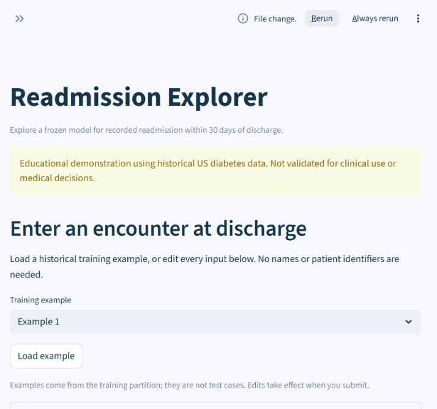
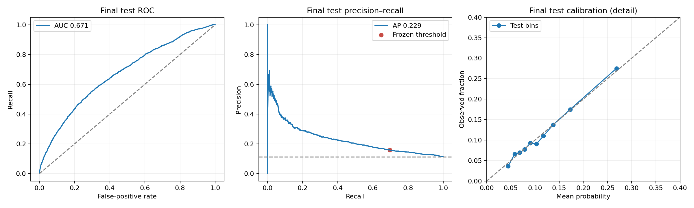
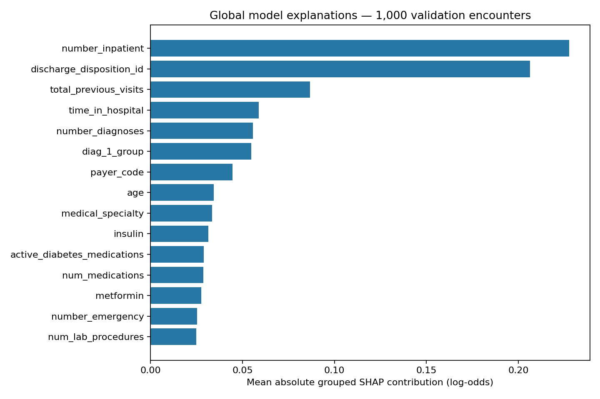

# Explainable 30-day hospital readmission prediction

Predict recorded 30-day readmission following a hospital encounter involving a patient with diabetes, using information available at discharge.

An end-to-end educational ML project with patient-separated evaluation, leakage-aware preprocessing, model comparison, calibration assessment, threshold selection, SHAP explanations, and an interactive Streamlit app.

## Run the application

Use Python **3.13**. The small frozen model is included; downloading the dataset or retraining is not required to run the app.

```bash
python -m venv .venv
# Windows PowerShell
.venv/Scripts/python -m pip install -r app/requirements.txt
.venv/Scripts/python -m streamlit run app/app.py --server.address 127.0.0.1
```

On Linux/macOS use `.venv/bin/python` for both commands. Open the localhost URL printed by Streamlit. The pages provide encounter prediction, live SHAP explanations, and held-out performance with calibration and demographic tables. Three ID-free training examples are provided; all 47 fields are editable.



## Final held-out results

The final model is histogram gradient boosting. It was selected by mean average precision in patient-grouped training cross-validation. The original probability output was retained because sigmoid calibration did not improve validation Brier score and log loss.

| Metric | Final test result |
|---|---:|
| Encounters / patients | 14,862 / 10,497 |
| Readmission prevalence | 11.30% |
| ROC-AUC | 0.671 |
| Average precision | 0.229 |
| Recall | 69.58% |
| Precision | 15.89% |
| F1 | 0.259 |
| Brier score | 0.09536 |
| Encounters flagged | 49.52% |

The fixed threshold **0.09737941008039629** targeted at least 70% recall on validation data. This educational objective catches many readmissions at the cost of a large alert workload: 6,190 false positives and 511 missed readmissions on test. It is not a validated clinical cutoff.



See [the final evaluation](reports/final_test/final_test_report.md), [patient-cluster confidence intervals](reports/final_test/patient_bootstrap_intervals.csv), and [demographic results](reports/final_test/test_subgroup_metrics.csv). The test set has been consumed; it must not guide further tuning.

## Methodology

- UCI diabetes encounter dataset: 101,766 raw encounters, 50 columns including identifiers and outcome.
- Exclude death/hospice and unclear completed discharges; 99,319 eligible encounters from 69,980 patients remain. Transfers are retained.
- Reserve approximately 70/15/15% of unique patients for training/validation/test. Patients never cross partitions.
- Fit imputation, scaling, and categorical encoding inside each training fold. Admission/discharge codes are categorical.
- Add previous-visit totals and medication activity/change counts; group diagnosis codes into broad categories.
- Compare logistic regression, Random Forest, and gradient boosting on identical three-fold patient-separated training folds.
- Assess training-only grouped sigmoid calibration; choose calibration and threshold on validation, then freeze all model artifacts before one final test scoring pass.
- Explain predictions with exact tree SHAP in log-odds. Contributions reconstruct pipeline scores; they are associations, not causal effects.



Detailed outputs: [data audit](reports/initial_data_audit.md), [cohort policy](reports/cohort_and_splits.md), [model comparison](reports/model_comparison/comparison_report.md), [calibration and demographic audit](reports/calibration/calibration_and_fairness_report.md), and [SHAP explanations](reports/explainability/explainability_report.md).

## Data and target

Open `notebooks/01_data_understanding.ipynb` for executed inspection outputs. `reports/column_inventory.csv` documents every raw column.

Target: `<30` = 1; `>30` and `NO` = 0. Retain `patient_nbr` for patient-disjoint splitting, excluding identifiers and `readmitted` from predictors.

## Reproduce

Install `requirements.txt`, download the archive using the URL in `data/raw/source.json` to `data/raw/uci_diabetes_130.zip`, then run `python scripts/understand_data.py` from the project root. This script executes inspection cells and writes a standard notebook with saved outputs; Jupyter is only needed for interactive notebook use.

Subsequent scripts are documented below. Existing freezes and test-evaluation markers are intentionally protected. For new research, use a separate experiment directory and a new evaluation design; do not overwrite the existing final evaluation.

## Deployment

See [deployment instructions](deployment/README.md). Community Cloud entrypoint: **app/app.py**; Python: **3.13**. The pinned runtime requirements live beside the entrypoint at `app/requirements.txt` so deployment does not select the separate frozen training requirements.

Generate an explicit runtime-only ZIP with `python scripts/package_deployment.py`. It contains the selected model, code, schema, and aggregate app reports; raw CSV data, unused models, encounter-level prediction files, secrets, and virtual environments are excluded. Only load trusted joblib artifacts. GitHub and hosting account access is required to publish; a local package is not a live deployment.

## Scope and limitations

Historical US diabetes records from 1999–2008 may not generalize to current care. The source does not establish complete cross-hospital follow-up or distinguish all planned readmissions. Missing data and retained transfers affect interpretation. Patient-separated testing does not provide temporal or hospital-level external validation. Demographic differences are descriptive and do not establish fairness. Almost half of encounters are flagged at the frozen threshold, with low positive predictive value. This app is educational, not clinically validated, and must not be used for medical decisions.

## Dataset attribution

Clore, J., Cios, K., DeShazo, J., & Strack, B. (2014). *Diabetes 130-US Hospitals for Years 1999–2008*. UCI Machine Learning Repository. https://doi.org/10.24432/C5230J. Licensed under CC BY 4.0. Raw data is excluded from Git; source URLs and checksums are retained locally in `data/raw/source.json`.

## Cohort and splits

Run `python scripts/create_cohort_splits.py` to regenerate the eligible cohort and fixed patient-disjoint partitions. See `reports/cohort_and_splits.md` for the exclusion policy, partition counts, and leakage checks. Assignments are stored in `data/processed/partition_assignments.csv` and excluded encounters in `data/processed/excluded_encounters.csv`; these local data files are excluded from Git.

## Baseline models

Run `python scripts/train_baselines.py` to fit full preprocessing/model pipelines for a prior-probability dummy, logistic regression, and class-weighted logistic regression. Results are saved to `reports/baselines/baseline_report.md` and `validation_metrics.csv`; pipelines are stored locally under `models/`. The reserved test partition is not evaluated. The run metadata records package versions and input checksums.

## Engineered model comparison

Run `python scripts/compare_models.py` to compare engineered logistic regression, Random Forest, and histogram gradient boosting on identical three-fold patient-grouped training splits. The winner by mean average precision is refitted on training data and evaluated on validation data, including threshold tradeoffs. See `reports/model_comparison/comparison_report.md`. The full pipeline is saved to `models/selected_engineered_model.joblib`; keep the `src` package importable when loading it from Python.

## Calibration and demographic audit

Run `python scripts/calibrate_and_audit.py` to fit training-only patient-grouped sigmoid calibration and compare it with the original model on validation Brier score and log loss. It uses a provisional educational objective of at least 70% validation recall, selecting the highest threshold meeting that target. Results, reliability plots, demographic tables, and limitations are in `reports/calibration/calibration_and_fairness_report.md`. The selected model path and exact threshold are saved in `models/operating_policy.json`.

## Explainability and frozen evaluation

`python scripts/explain_and_freeze.py` generates exact tree SHAP explanations for a fixed validation sample and six score-selected examples, verifies prediction reconstruction, and writes `models/frozen_manifest.json` before test access. This command refuses to replace an existing freeze.

`python scripts/final_test_evaluation.py` verifies the frozen hashes and evaluates the held-out test partition using the unchanged model and threshold. Saved metrics prevent fresh scoring on rerun; an exclusive start marker guards incomplete runs. Results are in `reports/final_test/final_test_report.md`, with calibration, demographic tables, patient-cluster bootstrap intervals, and plots. The test set is consumed after this evaluation and must not guide further tuning.

See `reports/explainability/explainability_report.md` for SHAP findings and the operating-policy rationale. Model associations are not causal explanations.

## Local Streamlit demonstration

Install pinned app dependencies with `python -m pip install -r app/requirements.txt`. The original frozen `requirements.txt` is preserved. Run from the project root:

```text
python -m streamlit run app/app.py --server.address 127.0.0.1
```

Open the localhost URL printed by Streamlit (usually http://127.0.0.1:8501). The three pages provide a raw-input predictor, live SHAP explanations of the last submitted encounter, and saved final-test performance/calibration/demographic results. Every model input is editable; hidden expanders retain the loaded training example's values. No arbitrary low/medium/high medical risk bands are assigned. The frozen threshold and model stay unchanged.

`app/assets/input_schema.json` supplies choices, bounds, and three ID-free examples derived only from the training partition; regenerate with `python scripts/prepare_app_assets.py`. The app does not need the raw dataset to run once these assets, model, frozen manifest, source feature code, and saved reports are present. Inputs live in Streamlit session state and are not written to a patient database. Only load the trusted model distributed with this project.

Run `python scripts/check_streamlit_app.py` for automated interaction and frozen-pipeline consistency checks. Results are saved in `reports/app_verification.json`.

## Next step

Prepare repository documentation and deployment packaging. No public hosting or deployment has been performed by the local app workflow.

This is an educational project using historical US data and is not validated for clinical use.
